# Prediction Model Based on Particle Swarm Optimization Algorithm SSA and CEEMDAN-BiLSTM-Attention

Predictive model based on CEEMDAN-BiLSTM-Attention optimized by SSA for sparrows
Include wind speed data, as well as the wind speed dataset and label set that have been generated and processed through CEEMDAN decomposition. The corresponding codes can be run, and there are also examples of CEEMDAN decomposition.
Based on the SSA-BiLSTM-Attention prediction model optimized by the Sparrow, there is a smaller MSE and MAE, which is particularly evident.
Includes the code for data preprocessing of CEEMDAN, and complete SSA-BiLSTM-Attention model prediction code, model evaluation code, visualization code.
Environment: Python 3.9
Preface
This paper, based on the preliminary introduction of wind speed data (dataset attached at the end), introduces a comprehensive application of the Complete Ensemble Empirical Mode Decomposition (CEEMDAN) and the SSA-BiLSTM-Attention prediction model, which is based on the Particle Swarm Optimization algorithm, to enhance the predictive performance of time series data. The core of this method lies in the use of the CEEMDAN algorithm to decompose the time series, followed by the optimization of the TBiLSTM-Attention model using the Particle Swarm Optimization algorithm. Through modeling the decomposed data, precise predictions can be achieved.
1. Wind Speed Data CEEMDAN Decomposition and Visualization
1.1 Import data
1.2 CEEMDAN Decomposition
Based on the decomposition results, CEEMDAN has been decomposed into 11 components, which are used as input for the SSA-BiLSTM-Attention model for prediction.
2. Data Set Creation and Preprocessing
\tDivide the dataset into training set and test set, with a ratio of 8:2.
3. Sparrow Optimization Algorithm
3.1 Introduction to the Sparrow Optimization Algorithm
Sparrow Optimization Algorithm (SOA) is an optimization algorithm based on the characteristics of bird behavior in nature. It simulates the optimization strategies of birds in foraging, migration, and social interactions. The SOA demonstrates good performance in solving various optimization problems.
The basic idea of the Sparrow Optimization Algorithm is to continuously optimize solutions in the search space by simulating the foraging behavior of birds. The process can be divided into three stages: foraging behavior, migration behavior, and social behavior.
1. Foraging Behavior: When searching for food, birds choose food sources that are closer and have higher fitness values. In the algorithm, each individual in the solution space is considered a food source with a fitness evaluation value. Birds select individuals with higher fitness values to find better solutions.
2. Migration Behavior: If birds do not find better solutions after searching around a food source for a certain period, they will choose to leave the current food source and continue searching for other food sources. In the algorithm, the position information between individuals will change to simulate the migration behavior of birds.
3. Social Behavior: When birds are foraging, they communicate with other birds to obtain more information and improve their foraging efficiency. In the algorithm, individuals exchange information to improve their solutions and update the optimal solution in the solution space.
\t3.2 Implementation of Sparrow Optimization Algorithm Based on Python
\t3.3 Superparameter Optimization Process of Sparrow Optimization Algorithm
The Sparrow Optimization Algorithm has the characteristics of simplicity, easy implementation, global optimization capability, and self-adaptability, making it suitable for solving combinatorial optimization problems. We use the Sparrow Optimization Algorithm to perform the superparameter optimization of the BiLSTM-Attention model.
By setting the appropriate population size and number of optimization iterations, we search for the optimal parameters within the given hyperparameters range.
4. Prediction Model Based on SSA-BiLSTM-Attention
\t4.1 Define the SSA-BiLSTM-Attention prediction model
\tNote:
\tInput dimension is 11, representing the 11 components of CEEMDAN decomposition
\tInput shape is torch.Size([64, 7, 11])
\tBatch size=64, where 7 represents the sequence length (the sliding window takes values)
\t4.2 Set parameters and train the model
\t50 epochs, MSE is 0.005526, the SSA-BiLSTM-Attention prediction effect is good, appropriately adjusting the model parameters can further improve the model prediction performance.
\tNote to adjust parameters:
\tModify the population size and optimization iteration times of the bird optimization algorithm;
\tAdjust the parameter search range for BiLSTM layers and dimensions, increase more epochs (note to prevent overfitting);
\tChange the sliding window length (set a suitable window length);
\tSave training results and prediction data
\t4.3 Model evaluation
\tComponent prediction, result visualization
\tFrom the component prediction results, it can be seen that the 11 components have a good fit in the SSA-BiLSTM-Attention prediction model, with high prediction accuracy.
\tOverall model evaluation:
\n        \n

## Images

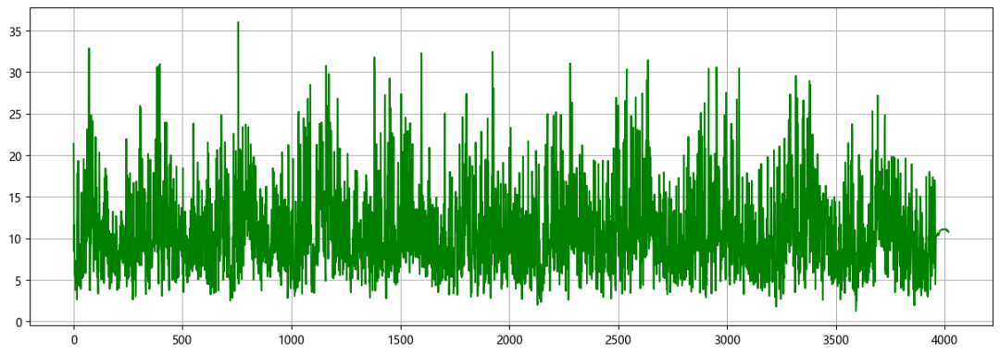
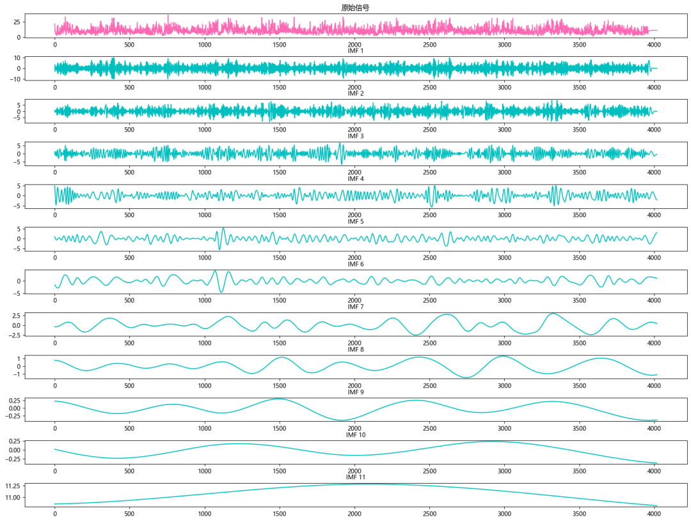
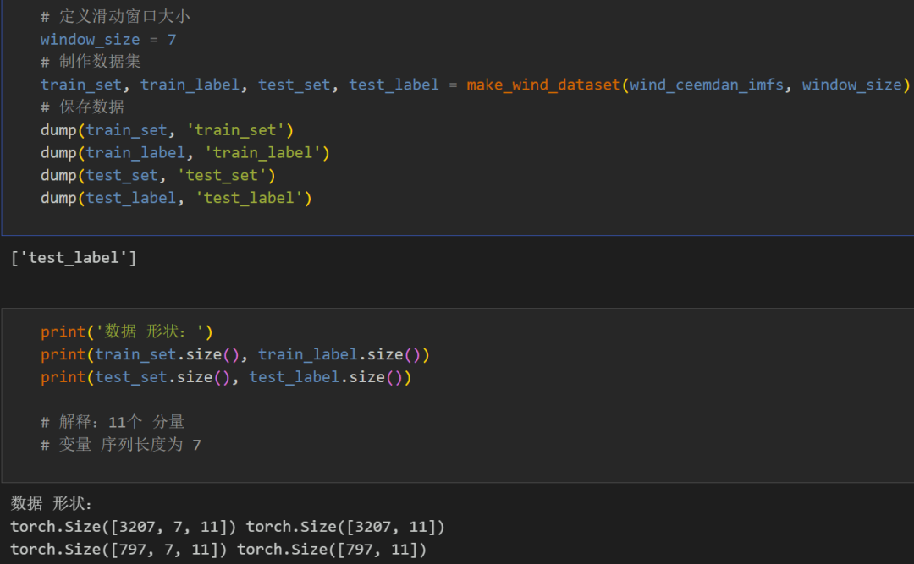
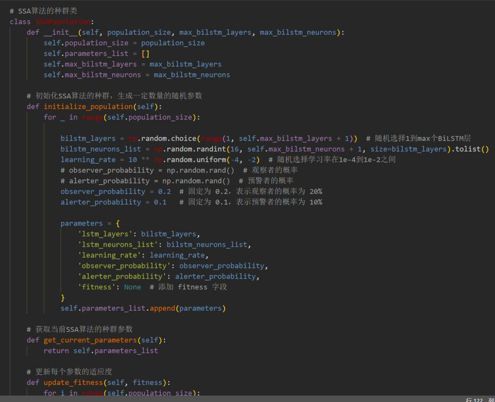
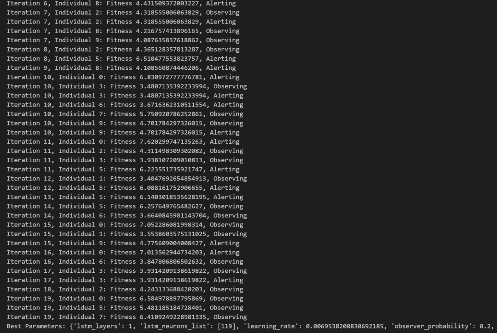
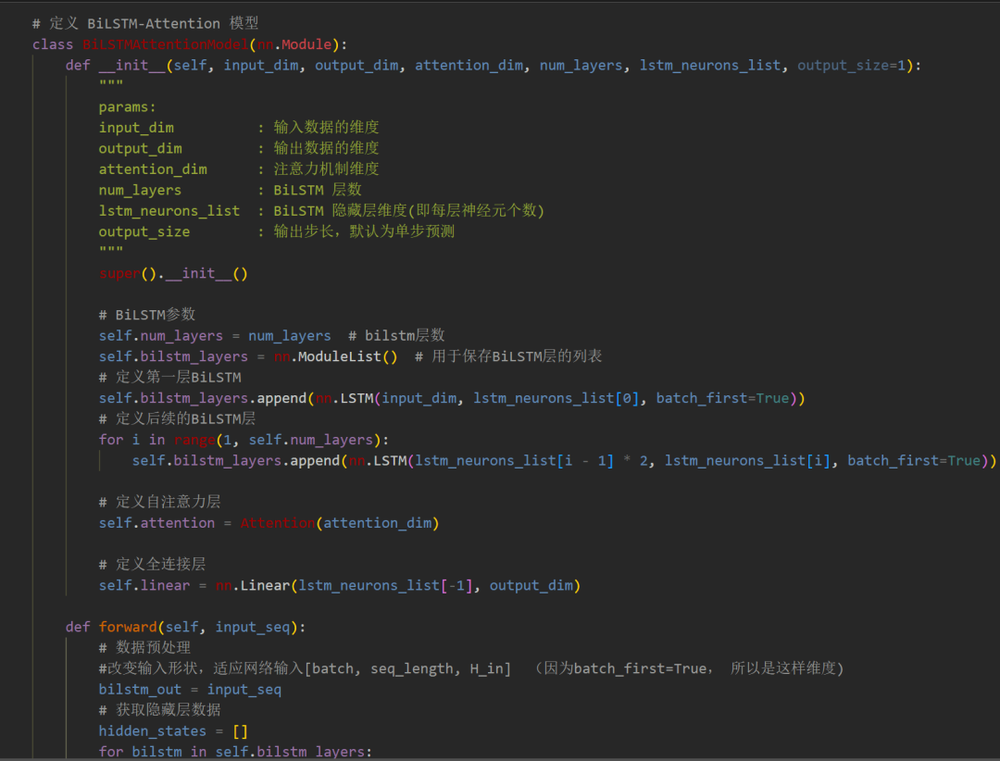
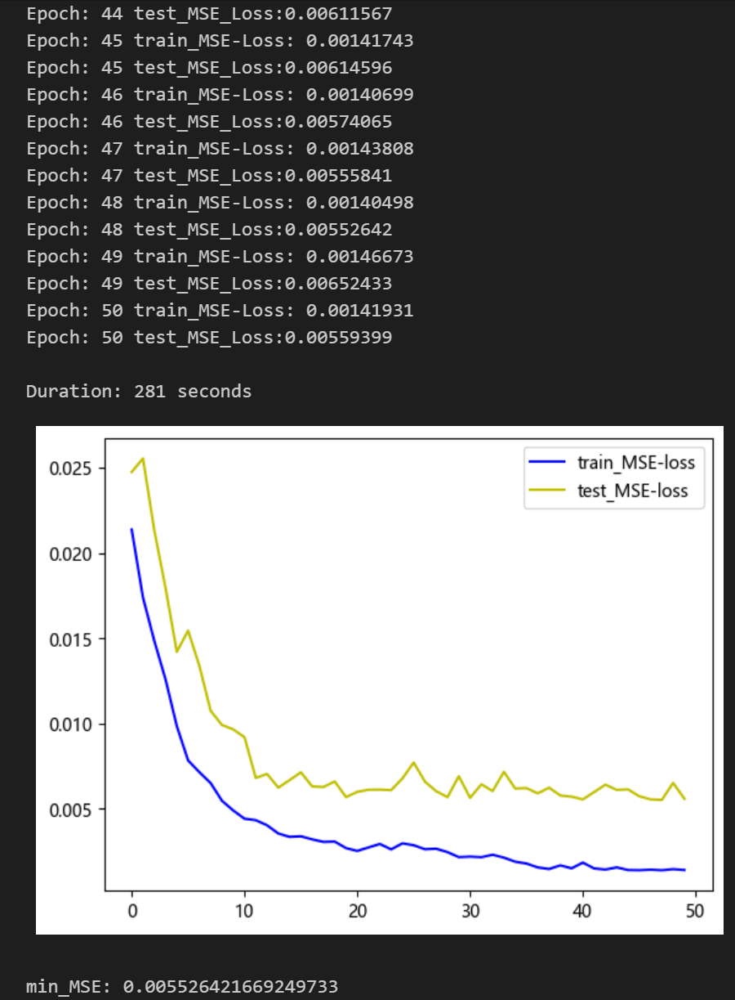
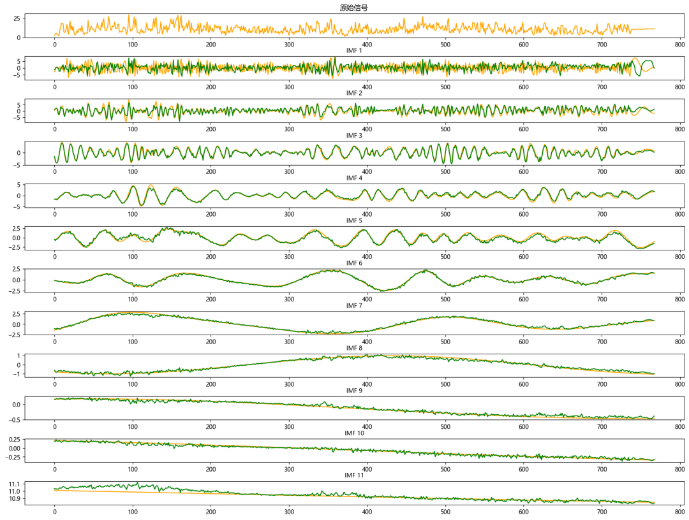
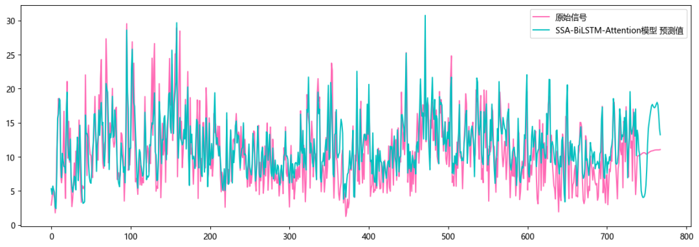
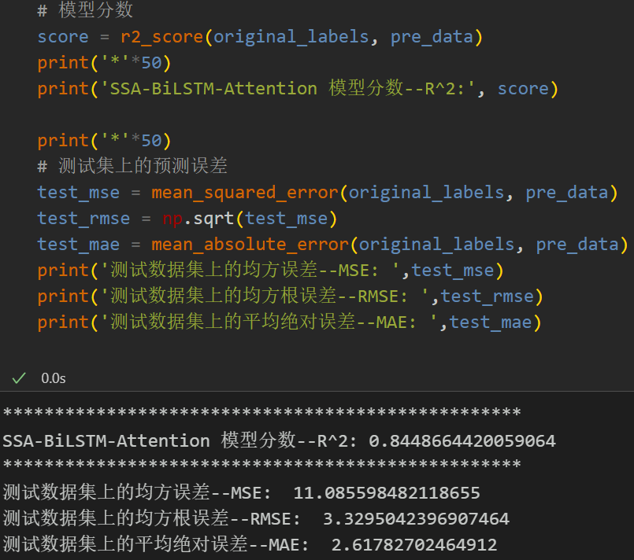
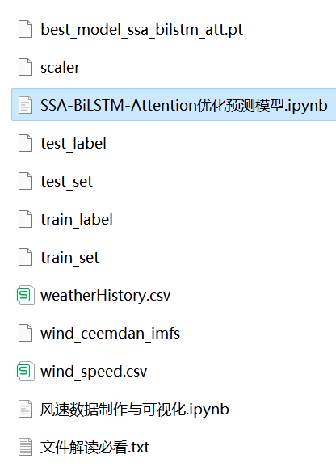
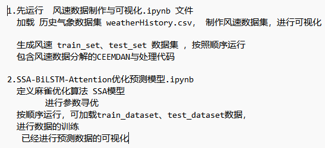

<!-- PAYMENT_BLOCK -->

## Get this dataset

- Payment link (Stripe): [Buy now](https://buy.stripe.com/3cs8yP7sY87d0vu9AB)
- Payment QR code: 

<!-- /PAYMENT_BLOCK -->
